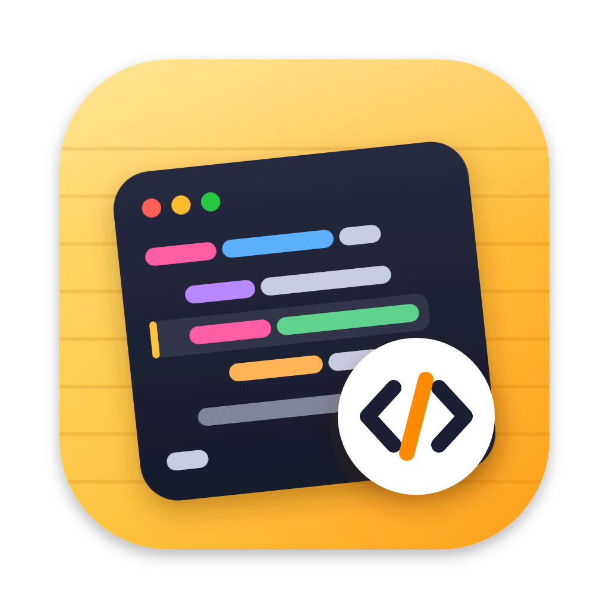
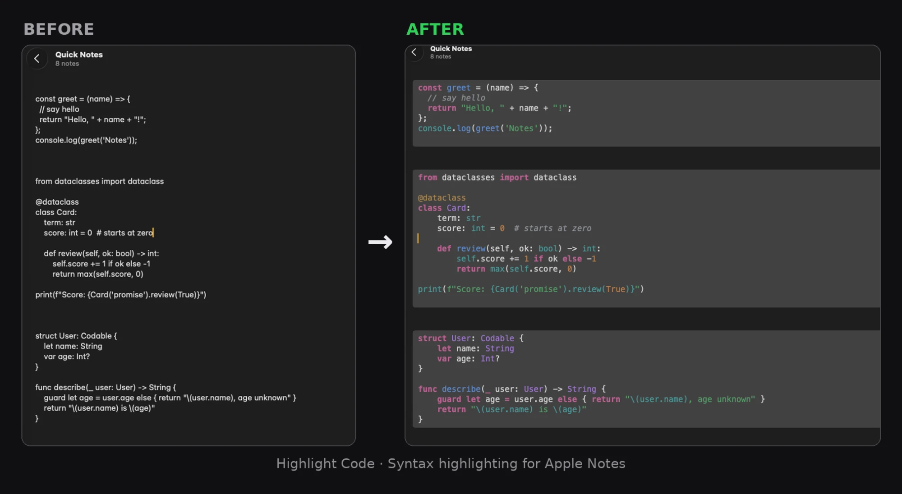
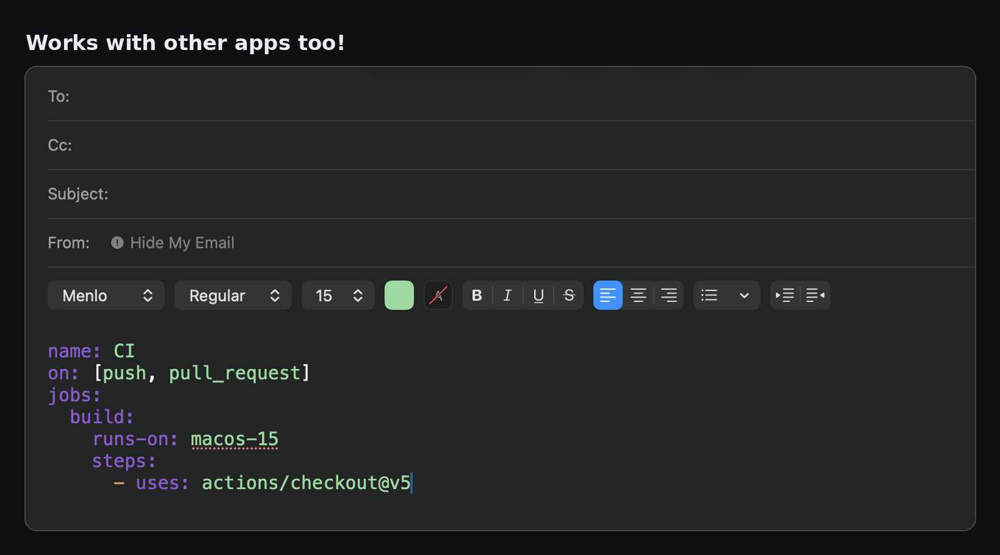

<p align="center">
  
</p>

<h1 align="center">Highlight Code</h1>

<p align="center">
  Syntax highlighting for code snippets in Apple Notes.<br>
  Select code → click <b>Highlight Code</b> → done.
</p>

<p align="center">
  <a href="https://github.com/haramrit09k/highlight-code/releases/latest/download/HighlightCode.dmg"><b>⬇ Download for Mac</b></a>
  &nbsp;·&nbsp; macOS 13 or later, Apple Silicon &amp; Intel &nbsp;·&nbsp;
  <a href="#install">Install help</a>
  <br><br>
  <a href="https://github.com/haramrit09k/highlight-code/releases/latest"></a>
</p>

<p align="center">
  
</p>

---

Apple Notes is great for study notes, but code in it is plain text: even the built-in
**Format › Monostyled** style is just monospaced, with no colours. Highlight Code is a
tiny open-source Mac app that adds syntax highlighting to Notes, without modifying Notes:

- **Floating button** (optional): select text in a note and a small
  **Highlight Code** button appears next to it.
- **Services menu**: right-click a selection › **Services › Highlight Code**, or use the
  **Notes › Services** menu. You can give it a keyboard shortcut too.
- **~60 languages** via [highlight.js](https://highlightjs.org), with automatic language
  detection. Markdown fences (` ```python `) pick the language explicitly and are removed.
- **Readable in light and dark mode**: plain code keeps Notes' own text colour; only
  keywords, strings, comments and so on are coloured, using a palette tuned for both
  backgrounds. Two higher-contrast themes are included as well.
- **Syncs everywhere**: the result is ordinary rich text in Menlo, so it looks the same on
  your iPhone and iPad.
- **Private and light**: highlighting runs entirely on your Mac, and your code never
  leaves it; the only network use is a daily check for updates. Without the floating
  button, the app quits itself when idle.

It works in other apps with rich text too (TextEdit, Pages, Mail, Keynote…):

<p align="center">
  
</p>

## Install

1. **[Download HighlightCode.dmg](https://github.com/haramrit09k/highlight-code/releases/latest/download/HighlightCode.dmg)**
   and open it.
2. Drag **Highlight Code** onto the **Applications** folder in the window that opens.
3. Open it from Applications. The first time, macOS asks you to confirm (see below).

**Or in one line** (Terminal), which also skips the confirmation:

```bash
curl -fsSL https://raw.githubusercontent.com/haramrit09k/highlight-code/main/install.sh | bash
```

Every release also has a `.zip` on the [Releases](https://github.com/haramrit09k/highlight-code/releases)
page. After installing, the app keeps itself up to date.

Requires macOS 13 Ventura or later, on Apple Silicon or Intel.

### "Apple could not verify…" (first launch only)

Highlight Code is free and open source, but not notarized by Apple (that requires a paid
developer account), so macOS asks once before opening it. The install script above
handles this for you. If you installed manually:

1. Open **Highlight Code** from Applications and click **Done** on the warning.
2. Open **System Settings › Privacy & Security**, scroll down and click **Open Anyway**
   next to "Highlight Code was blocked…", then confirm.

Or run this in Terminal, which does the same thing:

```bash
xattr -dr com.apple.quarantine "/Applications/Highlight Code.app"
```

You can always build it yourself from source instead (see [Development](#development)).

## Use

1. **Select code** in a note.
2. Click the floating **Highlight Code** button, or right-click › **Services ›
   Highlight Code**.

Open the app from Applications at any time to change the theme or font size, or to turn
the floating button on or off.

### Colours in Notes need Accessibility access

Notes drops the colours (and font) of pasted rich text, unless it's pasted with
**Edit › Paste and Retain Style**, which has no keyboard shortcut. (Plain Paste keeps
only bold and italic; Paste and Match Style, <kbd>⌥⇧⌘V</kbd>, keeps nothing.) With **Accessibility** access
(System Settings › Privacy & Security › Accessibility, or **Grant Access…** in the app),
Highlight Code does that for you, from both the floating button and the Services menu.

If the app still asks for access although it's switched on, the entry belongs to a
different build (builds made before 0.2, or built yourself, each have their own
identity). Remove **Highlight Code**
from the Accessibility list with **–** and grant access again, or run
`tccutil reset Accessibility io.github.haramrit09k.highlight-code` and reopen the app.

Without it, choose **Services › Copy Highlighted Code**, then **Edit › Paste and
Retain Style** in your note. Other apps (TextEdit, Pages, Mail…) keep the colours either way.

### The floating button

Turn it on in the app's settings window. It needs the **Accessibility** permission, the
same one screen readers and window managers use, so it can see what you select in Notes
and paste the highlighted version through Notes' own **Edit › Paste and Retain Style**. Your clipboard is
restored afterwards. Turn on **Open at login** to keep the button available after a
restart.

### Updates

Highlight Code updates itself with [Sparkle](https://sparkle-project.org): it checks
GitHub once a day and asks before installing. You can turn that off, or check now, at the
bottom of the settings window. Updates are signed, and the app only installs ones made
with the project's key. Your Accessibility permission carries over, because every release
is signed with the same (self-signed) identity.

### A keyboard shortcut

**System Settings › Keyboard › Keyboard Shortcuts… › Services › Text › Highlight Code**:
double-click to the right of the name and press a shortcut, e.g. <kbd>⌃⌥⌘H</kbd>.

### Choosing the language

Detection is automatic, but short snippets can be ambiguous. Wrap the code in a Markdown
fence to choose the language yourself; the fence lines are removed:

````
```rust
fn main() { println!("hi"); }
```
````

Aliases such as `js`, `ts`, `py`, `sh`, `yml` and `objc` work.

### Something not working in Notes?

Highlight Code writes a short log (what it pressed and pasted, never your code) to
`~/Library/Logs/HighlightCode.log`. Please attach it when reporting a problem.

### Not showing up in the Services menu?

- Make sure the app is in **Applications** and has been opened once.
- Check **System Settings › Keyboard › Keyboard Shortcuts… › Services › Text** and tick
  **Highlight Code**.
- Log out and back in, or run `/System/Library/CoreServices/pbs -update`.

## Why not a button in the Format menu?

macOS doesn't let one app add items to another app's menus. The only way to put a
button inside Notes' own menus is to inject code into Notes, which requires turning off
System Integrity Protection and breaks with every macOS update. Instead, Highlight Code
uses the extension points macOS offers: the system-wide **Services menu**, plus a
floating button drawn next to Notes through the **Accessibility API**.

## How it works

```
selection ──▶ Markdown fence? ──▶ highlight.js (in JavaScriptCore) ──▶ token scopes ──▶ theme ──▶ RTF
```

- `Sources/HighlightCore`: the engine. It parses fences, runs the bundled highlight.js
  in Apple's built-in JavaScriptCore, turns its HTML output into scoped tokens, maps scopes
  to theme colours and renders RTF.
- `Sources/HighlightCode`: the app. It provides the Services, the floating button
  (Accessibility API + a non-activating panel) and the settings window.
- `Resources/Info.plist` declares the Services (`NSServices`).

## Development

Requires Xcode 15+ (or the Swift 5.9+ toolchain) on macOS.

```bash
swift test                          # unit tests
scripts/build-app.sh 1.0.0          # → build/Highlight Code.app and build/HighlightCode-1.0.0.zip
scripts/smoke-test.sh --install     # end-to-end: CLI, snapshots and the real Services menu
```

The app also has a command-line mode, handy for scripts:

```bash
"/Applications/Highlight Code.app/Contents/MacOS/HighlightCode" --rtf < main.py | pbcopy
```

Other scripts:

- `scripts/update-highlightjs.sh [version]` updates the bundled highlight.js.
- The icon source is `Resources/AppIcon.svg`. After editing it, re-export
  `Resources/AppIcon.png` at 1024×1024.

**Releasing:** push a tag such as `v1.0.0`, or, from anywhere (a phone works), open
**Actions › Release › Run workflow** and enter the version. The Release workflow builds,
tests and signs the app, then publishes the DMG, the zip and the `appcast.xml` update feed
to GitHub Releases. Publishing a release with a new tag in GitHub's web UI works too: the
workflow adds the files to it.

Before the first release, run `scripts/setup-signing.sh` once on your Mac. It creates the
two keys releases are signed with and stores them as GitHub Actions secrets (it needs
the GitHub CLI, or use `--print` and paste them in by hand):

- a self-signed code-signing certificate, so every build has the same identity and keeps
  its permissions (free; it is not an Apple Developer ID, so Gatekeeper still asks once);
- an update-signing key, so installed copies only accept updates made by you.

Keep the backup it makes somewhere safe. With new keys, existing installs would lose
their Accessibility permission and could no longer verify updates.

The engine (`HighlightCore`, minus the macOS-only parts) also builds and tests on Linux,
which CI checks too.

## License

MIT, see [LICENSE](LICENSE). Bundles [highlight.js](https://github.com/highlightjs/highlight.js)
(BSD-3-Clause, see [Resources/highlight.js-LICENSE](Resources/highlight.js-LICENSE)).

Apple Notes is a trademark of Apple Inc. This project is not affiliated with Apple.
